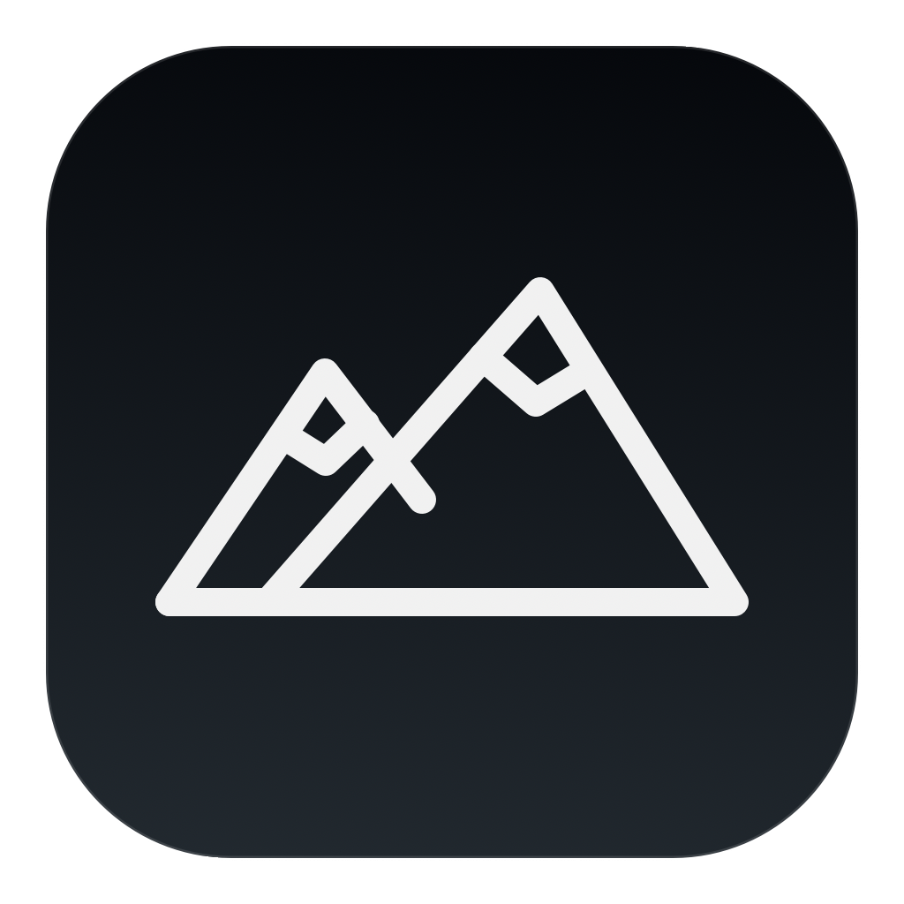
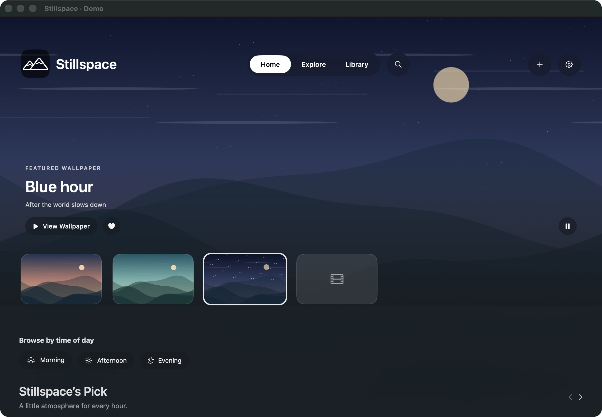
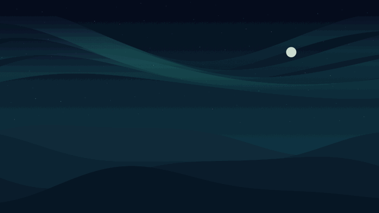
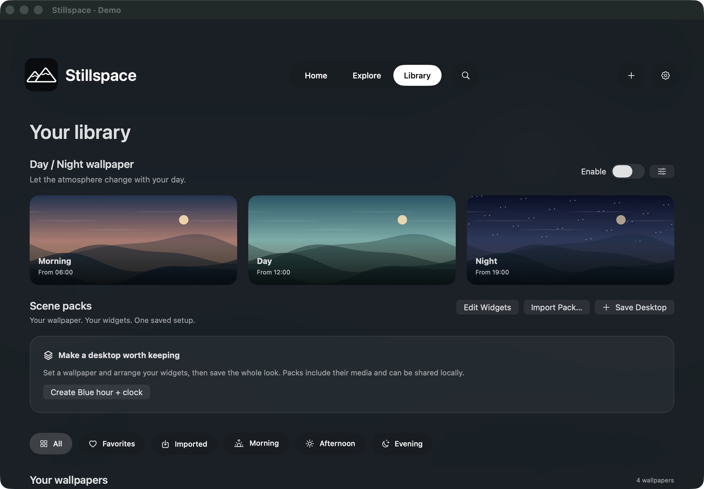
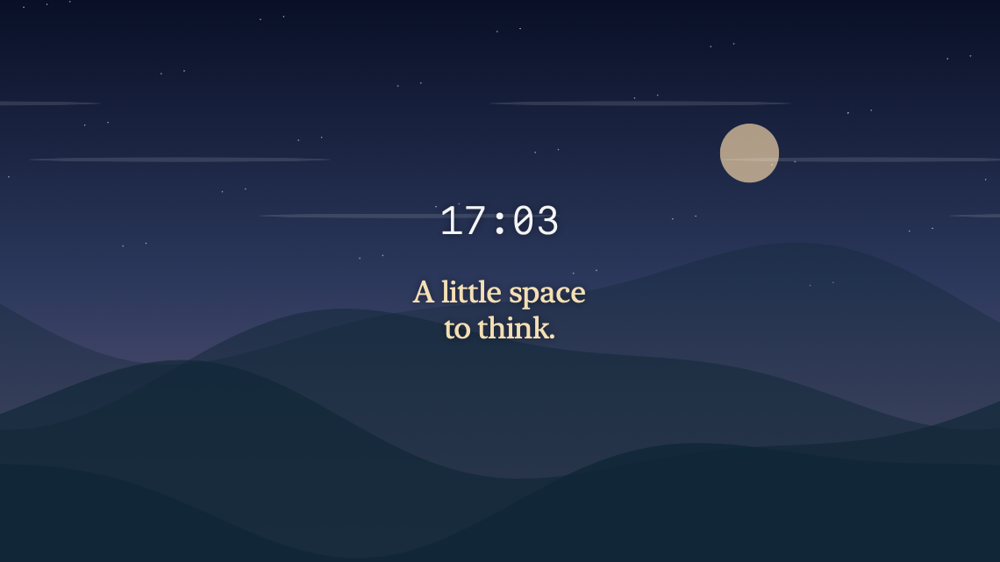

<p align="center"></p>
<h1 align="center">Stillspace</h1>
<p align="center">A little atmosphere for your Mac.</p>
<p align="center">Native SwiftUI · Video wallpapers · Multiple displays · Optional desktop widgets</p>



Stillspace is a personal macOS live-wallpaper app built with SwiftUI, AppKit and AVFoundation. Import your own MP4, choose a scene, and let it play behind your desktop icons. No account, advertising, analytics or online wallpaper service is built into the app.

**Version 1.3.4 · Personal preview.** Built for Apple silicon. The deployment target is macOS 14; Liquid Glass uses macOS 26, with material fallbacks on older systems. Intel and macOS 14 behavior still need validation. This project is independent of Wallspace and Wallpaper Engine.

## Try an animated wallpaper



**[Download Northern Drift — free MP4](Demo/Northern-Drift.mp4?raw=true)**

An original, silent aurora over layered mountains. 1920 × 1080, H.264, 30 fps, eight seconds, designed to loop continuously. The animated image above is a smaller, lower-frame-rate preview; use the MP4 in the app. The demo artwork is released under **CC0 1.0**, including commercial use; attribution is appreciated, not required. See [demo details and license](Demo/README.md).

1. Download the MP4 above.
2. Open Stillspace and press **Command–O**, or click **+**.
3. Select `Northern-Drift.mp4` and open its wallpaper preview.
4. Click **Set as Wallpaper**. Stop playback from the menu bar to reveal your regular desktop.

## What it does

- Loop local MP4 wallpapers with AVFoundation; previews stay silent.
- Choose wallpapers for individual displays, with Fill or Fit sizing.
- Three original built-in scenes: First light, Quiet tide and Blue hour.
- Switch built-in scenes by time of day; organize imports and favorites locally.
- Play the MP4's audio or attach your own audio file, with per-wallpaper volume.
- Add optional clock, date, custom text and Mac information widgets. Edit their layout directly, without a Settings detour.
- Save and share local `.stillscene` scene packs containing media, widget layout and sound preferences.
- Use compact menu-bar playback controls; closing the library keeps playback available.
- Pause on battery when enabled, when displays sleep, while locked, or under serious thermal pressure. Low Power Mode pause is configurable.

There is no Pomodoro timer, generated ambient audio, public community catalog, AI search, plugin execution or Pro plan.

## Build and run

Use Xcode 26 or newer, or Apple Command Line Tools with the macOS 26 SDK.

```sh
git clone https://github.com/Mattan-a11y/Stillspace.git
cd Stillspace
./build.sh
unzip Stillspace.zip
open Stillspace.app
```

The script builds an optimized app for the current Mac's architecture in a temporary directory, locally signs it, verifies the signature, and writes `Stillspace.zip`. It has no third-party package dependencies. Alternatively, open `Stillspace.xcodeproj` in Xcode, select Stillspace and Run. Development signing may need your own team configuration.

**[Download the Apple-silicon preview app](https://github.com/Mattan-a11y/Stillspace/releases/tag/v1.3.4)**. Local builds are **ad-hoc signed, not Apple-notarized**. macOS may block a downloaded preview build; building locally is the recommended route until Developer ID signing and notarization are available. This repository does not disable Gatekeeper or request reduced system security.

## Library



## Desktop widgets



Open a wallpaper preview and choose **Edit Widgets**. Add only the widgets you want, drag to position, resize, and choose fonts and colors. **Apply to Desktop** saves; **Cancel** discards the draft. Layout positions are relative to the display; currently the same widget layout is shared across displays.

The Home and Library images are captures of the actual app views in a separate documentation preview, with only original demo content. The widget image is a rendered example layout, not a default overlay. Personal imports are excluded.

## Screen saver and lock screen

The optional macOS 26 screen-saver integration is **experimental**. It prepares a silent video and registers it in an undocumented user-space aerial catalog only when explicitly requested. It is not a supported Apple API and may stop working after an OS update.

In Settings, choose a screen-saver scene and **Prepare … for Screen Saver**, then select it under macOS **Wallpaper → Screen Saver → Custom → Stillspace**. Keep your ordinary desktop wallpaper selected separately. Locking initially shows the ordinary lock-screen background; the prepared animation runs only when macOS starts the screen saver. Continuous locked-screen motion is not guaranteed. Audio and desktop widgets are excluded. Stillspace does not change password requirements, display-sleep timing or lock security.

## Privacy, performance and storage

Wallpapers and settings stay on the Mac. Imports are copied into `~/Library/Application Support/Stillspace/`; moving the original file will not break that copy. Removing an imported wallpaper can remove the app's owned copy, so retain originals you want to keep. No private imports or audio are included in this repository.

Desktop playback uses click-through windows and leaves the regular macOS wallpaper in place. The engine reuses a player across displays showing the same scene and caches thumbnails. Energy use depends on resolution, codec, frame rate, screen count and the Mac. There is **no blanket under-2%-CPU, 60-fps or battery-life claim**.

## Project layout

| Path | Purpose |
| --- | --- |
| `Sources/App.swift` | Native library, wallpaper previews, quick controls and settings |
| `Sources/Model.swift` | State, local imports, preferences and scheduling |
| `Sources/Desktop.swift` | Desktop windows, video playback and built-in artwork |
| `Sources/PlaybackPolicy.swift` | Power, sleep and thermal pause policy |
| `Sources/WidgetLayout.swift` | Widget arrangement and editor |
| `Sources/ScenePacks.swift` | Portable scene-pack validation and storage |
| `Sources/MediaManagement.swift` | Media details, cleanup guards and app lifecycle |
| `Sources/LockScreen*.swift` | Experimental screen-saver export and registration |
| `Demo/` | Shareable original animated wallpaper and preview |
| `Tools/` | Reproducible demo and documentation renderers |
| `Tests/` | Playback, scene-pack, export and performance checks |
| `Distribution/` | Staged installer and optional notarization helper |

## Checks

```sh
./Tests/reliability.sh
./Tests/check.sh
```

The checks use temporary fixtures. `Tests/check.sh` exercises scene-pack portability and media guards; it does not prepare a live screen saver. See [testing notes](Docs/Testing.md) for scope and remaining limitations. The source and demo are provided for review and testing; this is not yet a notarized public release.

## Rights

The **Northern Drift demo assets and their generator** are CC0 1.0. The application code and other assets have **no open-source license granted by this publication**; rights are reserved unless separately stated. Publishing the repository does not grant permission to redistribute or sell the application. See [LICENSE.md](LICENSE.md) and [artwork inventory](Artwork-Rights.md). Only share wallpaper files you have permission to distribute.
